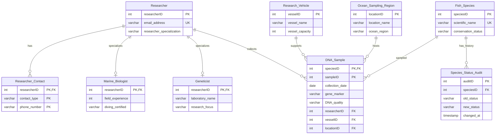

# Entity relationships

The diagram reflects the existing schema. DNA sample IDs are species-local; researchers may have either, both or neither subtype. Contacts have a three-column key. Audit entries restrict deletion of their species.

For full columns, types, nullability, CHECKs and indexes, use `database/schema/01_create_tables.sql`; this compact diagram intentionally shows the key relationships and selected descriptive attributes.
